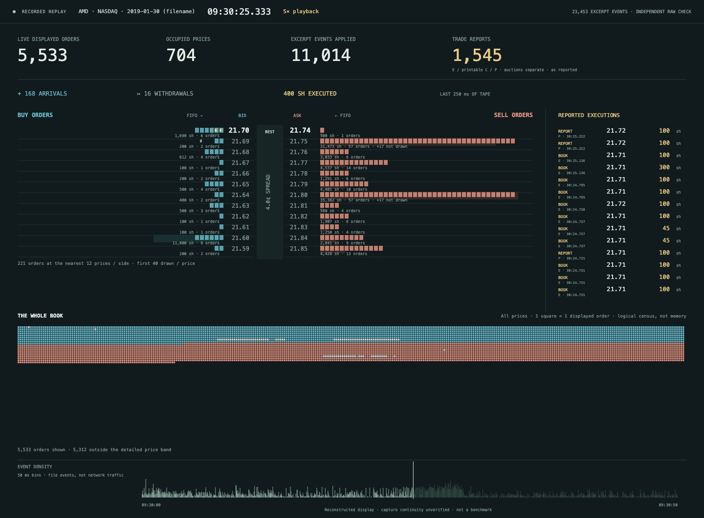
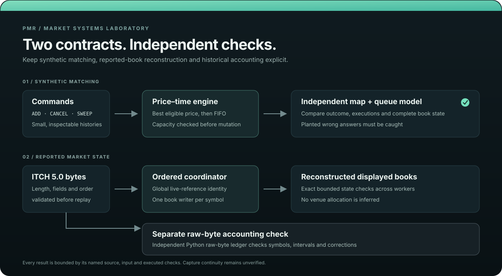

# PMR Market Simulator

**A price-time order book and a Nasdaq ITCH replay, with independent checks for both.**

[Watch the AMD replay](docs/replay/assets/amd-open-5x.mp4) · [Step through matching](docs/replay/index.html) · [Follow a feed example](docs/replay/feed.html) · [Reproduce the checks](docs/reproduce.md)

[](docs/replay/assets/amd-open-5x.mp4)

**The clip:** 23,453 reported Nasdaq TotalView-ITCH 5.0 events from a selected 50-second AMD excerpt, shown in 10 seconds at 5×. The date comes from the input filename. Capture continuity and public display rights are unverified; the raw input is not included.



## Two systems. Two different questions.

The matching engine answers: **given these orders and this price-time policy, what trades?**

The ITCH reconstructor answers: **given these reported messages, what displayed state follows?**

It does not invent executions between those paths or claim to reproduce Nasdaq's allocation decisions.

## A cancellation is not a fill

The short [feed example](docs/replay/feed.html) puts the distinction on screen. A hypothetical bid joins behind 100 shares. Ninety shares cancel; thirty execute. The optimistic scenario removes the canceled quantity from ahead. The pessimistic scenario leaves it there.

At 300 ms the displayed price empties. The two scenarios still disagree about execution service.

That is the point of the study: **a displayed price emptying is not proof that an order would have filled.** In the historical panel, 1,130 one-share entries produce 2 pessimistic and 3 optimistic service opportunities under those explicit assumptions. These are not bounds on actual venue fills.

The [matching visualizer](docs/replay/index.html) makes the other contract concrete: four synthetic scenes, including sweeps across prices, FIFO priority and capacity rejection. Every command, execution and complete queue state is checked against the independent C++ reference book. The browser draws saved results; it does not perform matching.

## What the checks found

- **1,103,762** book states were matched against a separately structured reference across every prefix of exhaustively enumerated short histories.
- **310,120** historical symbol/five-minute accounting cells agree across two different accounting paths, including corrections.
- **13.424199%** of correction-adjusted `E` + printable `C` + `P` shares in that one input were reported as `P`. See the [denominator and limits](docs/market-data.md#a-separate-volume-result); this says nothing about hidden depth, aggressor side or a trading signal.

The tape viewer can show a checked local export, but the repository does not include the raw tape or a preloaded viewer export. [Open the viewer](docs/replay/tape.html) to inspect its controls and load an export you generated locally.

## Run the demonstration

Requirements: Python 3.12 or later, CMake 3.20 or later and a C++17 compiler. The synthetic demo needs no market-data download.

```sh
python3 scripts/run.py verify --build build-release --out results/release --config Release --jobs 2
python3 scripts/run.py demo --build build-release --out results/demo
```

The demo starts from a 710-byte, 23-message session. It joins reconstruction, queue withdrawal, execution service, replenishment and a broken trade. A seven-share `P` report is later broken: its corrected volume is zero, while the displayed book stays as reported.

## What passed; what remains open

- **macOS Release:** 23/23 checks pass for source `6ca67b5`; the seven-stage demo and checked archive reconstruction also pass.
- **Linux ARM64 TSan:** 15/16. A child process hit SIGBUS under a forced file-size limit; the cause remains unknown.
- **Performance:** the retained host measurements have `strict_release_admissible=false`. They support no dedicated-host or full-day feed-throughput claim.
- **Historical input:** one previously examined day, 32 preselected symbols, visible displayed state only. Capture continuity and current input availability are unverified.
- **Video:** one selected excerpt is included. Public display rights and capture continuity are unverified.

The source and executable identities for each receipt are in the [revision record](docs/results/revision.json), [verification results](docs/results/verification.json) and [claim register](docs/claims.md). Later presentation work does not silently upgrade an older measurement.

This is a research and verification project. It has no live routing, venue-equivalent matching, profitability claim or production-deployment claim.

## Explore by question

| If you want to know… | Start here |
| --- | --- |
| How matching, FIFO and capacity work | [`src/order_book.cpp`](src/order_book.cpp), then the [text walkthrough](docs/demo.txt) |
| How independent matching checks are built | [`src/reference_book.cpp`](src/reference_book.cpp), [`tests/differential_test.cpp`](tests/differential_test.cpp) and [engineering notes](docs/engineering.md) |
| How ITCH messages become per-symbol state | [`src/replay.cpp`](src/replay.cpp), [`tools/itch_replay.cpp`](tools/itch_replay.cpp) and [replay boundaries](docs/engineering.md#replay-validate-identity-before-partitioning) |
| How corrections change reported volume | [`tools/itch_volume.cpp`](tools/itch_volume.cpp) and the [historical study](docs/market-data.md) |
| What the timing numbers mean | [Performance notes](docs/performance.md) and the [reproduction guide](docs/reproduce.md) |

Project-authored source is Apache-2.0. [NOTICE](NOTICE) records external algorithm and sample provenance. This project contains no employer code or data.
