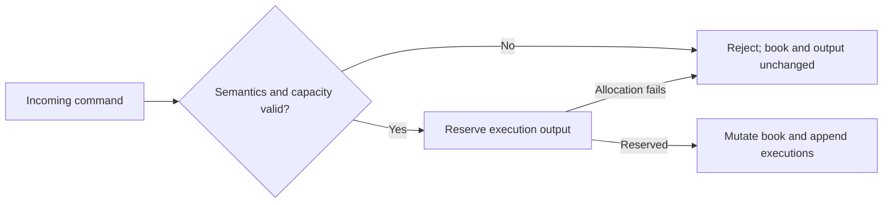

# State, ownership and failure boundaries

This project contains two state machines. Keeping their contracts separate is the first rule of the code.

| Path | Input | What it decides |
| --- | --- | --- |
| [Matching engine](../src/order_book.cpp) | Synthetic add, cancel and trade-through commands | Which resting order each command reaches under the stated price-time policy |
| [Feed book](../src/feed_book.cpp) | Reported ITCH events | What displayed order state follows those reports |

An ITCH add does not trigger synthetic matching. Later `E` and `C` messages report reductions. A locked or crossed display can be real reported state; by itself, it is not evidence of corruption or of the venue's allocation rule.

## Matching: decide before mutating

An incoming order takes the best eligible opposite price, then the oldest resting order at that price. It executes at the resting price. Any remainder joins the tail of its own price queue.

```text
accepted quantity = executed quantity + rested quantity
```

Prices are integer ticks. `book_demo` prints cents; ITCH prices use $0.0001 units.

### Capacity is part of the contract

A free slot on the opposite side does not necessarily make room for the incoming remainder. The engine checks the incoming side and level before changing the book.

Consider a sweep with two order slots occupied. The sweep may retire an opposite order, then reuse that slot for its remainder. An exact fill needs no new slot. But if the remainder opens a new price level, that side must still have level capacity. A read-only pre-scan compares available capacity with the remaining order quantity before adding; this also avoids overflow when total opposite quantity exceeds signed 64-bit range.

`add` appends executions to caller-owned output. A semantic rejection preserves both the book and output. If output space is insufficient, the engine reserves it **before the first mutation**; allocation failure also preserves both. Once mutation begins, execution records are nothrow. The command adapter `apply` clears old per-command output separately. An invalid command-type discriminator throws before that clear.



This is the matching engine's admission boundary. Feed reconstruction has a different failure contract, described below.

## Storage: one owner for each live order

Fixed node and level arrays use 32-bit indices and intrusive FIFO links. A node belongs to exactly one live queue or the free list. Each live ID points to that same node; price ladders, hashes and queue endpoints must agree. The caller must keep the PMR resource alive until the book is destroyed. Each book has one writer.

Both ladders keep their best price at the back. Bids sort by tick; asks sort by negated tick. The feed uses the complement of its unsigned price. Best-price access and removing an emptied best level touch the back of the array. Nearby changes use a short backward scan. A deeper change uses binary search and can move O(L) entries.

| Operation | Cost and boundary |
| --- | --- |
| Best price | Read the sorted ladder's best end |
| Add touching k orders | Expected O(k) index/queue work, plus incoming-level search/movement and any capacity pre-scan |
| Cancel | Expected constant lookup/unlink; emptying an arbitrary price can move O(L) ladder entries |
| Hash operation | Expected constant time; worst case linear in table capacity |
| Snapshot or invariant check | Allocates separately; hash validation can be quadratic |

These bounds assume valid owned storage. They do not cover arbitrary memory corruption or concurrent mutation. Feed-ladder allocation failure invalidates the replay; those updates do not have the matching engine's per-command rollback guarantee. The [measured comparisons](performance.md#data-structure-trade-offs) favor the vector in five of six tested cases and the tree only for 4,096 uniformly changing levels. They do not establish a universal market locality pattern.

The matching engine has a separate level hash. Backward-shift deletion moves a later entry into a hole only when that hole lies on the key's cyclic probe path. Leave a hole on that path and a still-live order can become unreachable.

The feed book uses its sorted ladder as the price index. Existing-level lookup is O(log L) after the bounded scan; opening or closing an arbitrary level can move O(L) entries. Its reference index keeps recent IDs in a direct ring and older or far IDs in a hash. A ring miss still checks the hash when the window catches up with a far reference. Before moving the window, the code counts all required migrations and rejects insufficient hash capacity without changing ownership.

### The memory price of a fast path

- The default reference ring reserves **64 MiB per map**, including every worker and the coordinator's live-identity map, before other storage.
- Benchmarks use 18-bit windows instead of the default 24-bit windows.
- A separate sparse day census rejects reuse of retired ITCH birth references. Its default cap permits **512 MiB of bit storage plus indexing overhead**, allocated on demand.
- Synthetic engine IDs may be reused after retirement. ITCH birth references may not be reused during a complete session.

## Replay: validate identity before partitioning

The supported modeled messages are `S/R/H/h/W`, `A/F/E/C/X/D/U`, `P/Q/B` and `I`. Known `Y/L/V/K/J/N` messages receive exact length and header checks; unused payload business rules are outside the contract. Unknown message types reject.

For a complete session, the modeled contract requires ordered `O/S/Q/M/E/C` system events, directory identity before use, matching stock/locate fields, and `A/F/U` births during `S/Q/M` system hours. Research also interprets trading and operational state. A halt does not manufacture order cancellations.

Before dispatching a message to a worker, the [replay coordinator](../src/replay.cpp) validates global live IDs, quantities and day-unique births. Locate modulo worker count assigns each symbol to one book owner. Workers keep file order; `S/W` events are broadcast. One-worker replay uses the same pipeline as multi-worker replay, plus a coordinator thread.

Two chunk buffers carry explicit generations. A buffer can be reused only after every participant retires that generation. Startup gates join partially launched workers. If a worker fails, the coordinator drains the current generation and joins the threads.

**A failed run publishes no canonical result.** Its diagnostics are not promised to describe a coherent ordered prefix. Arbitrary asynchronous thread termination and broken synchronization primitives are outside the contract.

Input is a regular file read through its initial extent. The reader hashes consumed bytes and checks descriptor/path metadata through finalization. Keep the input read-only. This detects ordinary mutation; it cannot prove that a privileged process did not rewrite it or that the source never omitted complete messages.

Success requires exit code zero, a final success record and the requested publication step. Caught write, flush and rename failures attempt rollback. Filesystem and stdout publication are not a crash-durable distributed transaction.

### Input identity

The [SHA-256 wrapper](../include/msim/sha256.hpp) uses CommonCrypto on macOS and the retained portable implementation elsewhere, or when explicitly selected. It hashes bytes as they are consumed—not a separate pre-read or independent chunks.

CommonCrypto's 32-bit update length is handled by splitting larger requests. `hex()` finalizes a value copy, so asking for a digest does not consume the running prefix or corrupt another copy. Provider selection does not change matching, global identity, buffer ownership or file-change checks.

## How the implementation is challenged

The matching reference uses maps and deques. It simulates capacity on copies instead of sharing the engine's pre-scan. Bounded comparisons check every execution and the complete FIFO state. Large seeded streams check every outcome and execution, with periodic full-state comparisons.

The [exhaustive test](../tests/exhaustive_test.cpp) enumerates every prefix through depth four across three IDs, two prices/quantities and two capacity profiles: **1,103,762 prefixes**, without merging equal public states.

| Failure surface | Independent check |
| --- | --- |
| Feed transitions | Separate map/queue reference in [feed tests](../tests/feed_book_test.cpp) |
| Replay ownership and worker count | Exact terminal state, metadata, day references and cross records across workers, chunks and index modes |
| Capacity, parsing and identity defects | Planted FIFO, cancellation, capacity, hash, parser and reference-retirement mutations |
| Operational failures | Truncation, wrong ownership, collisions, exhaustion, startup/worker faults, source changes and output failures |
| End-to-end lifecycle | [Closed loop](../tests/closed_loop_test.cpp) connects matching executions to independently encoded feed lifecycles |

Signal crashes cannot masquerade as ordinary semantic rejection. Historical raw-byte checks cover the emitted event observations and accounting described in the [study](market-data.md).

These are finite checks of named failure mechanisms. They do not establish Nasdaq matching equivalence or prove the absence of every defect. See [executed platform results](reproduce.md), including the failed Linux TSan profile.
