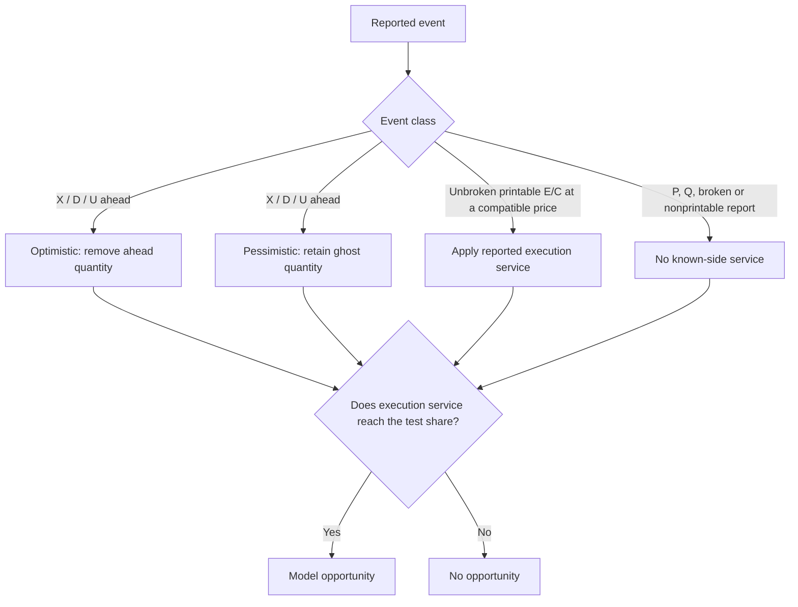

# Displayed queues and execution service

## Does an empty price mean a fill?

Not necessarily. A cancellation can move an order forward in the queue; execution service is still required.

In this study, 142 admitted entries saw their original price empty. Under two explicit service assumptions, only **2 pessimistic** and **3 optimistic** one-share opportunities were recorded. Those outcomes are not bounds on actual venue fills.

A second result comes from the same historical file: corrected `P` messages account for **13.424199%** of eligible reported executed shares. That fraction says nothing about hidden depth, aggressor side or a trading signal.

> **Scope:** one previously examined day, 32 preselected symbols, reported displayed state. Capture continuity and current access to the source file are unverified. The raw file is not distributed.

## The input and the panel

The input is a file labelled **2019-01-30**, 11,245,883,092 bytes, SHA-256 `1d0972ffc25b35902ccc3f9069aae517da56903d5795f872902b8697315f30c3`. The date comes from its filename; ITCH timestamps do not encode calendar dates.

The [study receipt](results/study.json) identifies implementation `e7c251cfe55afd3196bc69ad084828ae564186da33683c34103fb7caaf2c8907`. The [revision record](results/revision.json) keeps later comment, SHA-provider and presentation changes separate. The study was not rerun for those revisions because reconstruction and research formulas did not change.

The 32-symbol panel was selected before examining its outcomes: Nasdaq-listed, pre-market-directory symbols marked authenticity `P`, ordered by the SHA-256 of each exact eight-byte stock field. The [full panel](results/panel.csv) is retained; no symbol was swapped out based on its result. This repeatable selection is not a random sample of the market. Definitions were fixed before the panel was run, but the day was already known from accounting development; it is not a holdout.

### Sample selection and censoring

- **Order:** file ordinal determines event order. Timestamps measure reported event duration, not packet latency.
- **Admission:** primary observations require observed market hours, `H:T` trading state, no observed Nasdaq operational halt and positive two-sided display. “No halt observed” does not certify venue availability.
- **Clock regressions:** active observations are censored until event time catches the previous high-water mark. `H/h/W` and session stops are recorded separately from order cancellations.
- **Horizon:** the primary service horizon is one second. Complete lifetime exposure is determined separately from whether the subject ends early; late births stay visible but do not enter that denominator.
- **Spread and sensitivity:** `ONE_CENT`, `WIDER` and `SUBCENT` are observed-spread bins, not structural tick-size classes. Whole-symbol and half-hour sensitivity tables retain zeros and missingness.

These are finite-input descriptions. No IID message/share confidence intervals, causal interpretation or cross-day generalization is claimed.

## What the event stream showed

| Measure | Result | How to read it |
| --- | ---: | --- |
| Displayed order births | 331,675; 331,393 complete; 282 late | Adds and replacements begin separate order spells |
| Complete terminal E/C endpoints | 4,145 / 331,393 (1.2508%) | An execution ended the order within one second, possibly after a partial cancellation; it need not have executed the original quantity |
| Admitted best-level emptyings | 40,792 | The pre-event best price became empty; displacement by a better, nonempty price is separate |
| Same-price returns within one second | 11,893 returned; 28,894 did not; 5 censored | 10,899 returns restored the best price; 994 returned away from the best |
| Fixed passive entries | 1,130 complete; 3,926 unavailable side slots | Missing opportunity is unavailable, not a zero outcome |
| Original entry-price emptyings / loss of best | 142 / 269 | The hypothetical order stays at its entry price; it does not chase |
| One-share service opportunities | 2 pessimistic; 3 optimistic | Outcomes under the model below |

The [queue table](results/queues.csv) separates initial shares ahead, changes to the hypothetical order and departures ahead. There were 4,149 raw E/C terminal endpoints; four lacked complete exposure and are excluded from 4,145. One departure can affect many hypothetical orders, so summing queue-ahead quantities is not unique market-wide cancellation volume. ILMN supplies 2,626 of the 4,145 complete endpoints; the [symbol](results/symbols-sensitivity.csv) and [time-block](results/blocks-sensitivity.csv) tables show how much the pooled result depends on composition.

The [depletion tables](results/depletions.csv) retain cause, gross execution and withdrawal contributions, return timing and conditional level age. Deletion or replacement caused 31,096 of 40,792 terminal emptyings (76.23%): an event fraction, not a share-volume fraction. With five censored units, the finite-input one-second same-price return fraction is 29.1552%–29.1675%.

Age here measures an observed positive-price-level spell ending in an admitted best-level emptying. It includes time away from best and time outside trading hours; a level that stays positive is not an age observation. A same-price replacement can keep the level positive while ending the old order spell and its priority. Returned-only medians are conditional on a return.

## The one-share experiment

The model places a one-share hypothetical order at the back of each displayed best-side queue shortly after the first symbol event in the first second of a fixed five-minute bin. The observed session intersects 79 bins, including a short final boundary bin:

```text
32 symbols × 79 bins × 2 sides = 5,056 possible entries
1,130 entries admitted; 3,926 side slots unavailable
```

Initial displayed quantity is ahead. Later order births are behind. The two scenarios differ only in their treatment of known-ahead cancellations:

- **Optimistic:** remove actual `X`, `D` and `U` withdrawals ahead.
- **Pessimistic:** leave that quantity ahead as “ghost” shares until execution service consumes it.

MBO identifies the canceled order and its reconstructed position. The ghost shares are an imposed sensitivity case, not uncertainty about which order canceled. The model never searches later for a more favorable entry.

Service comes once from each distinct, unbroken printable `E` or `C` report at the referenced resting level, with a positive execution price compatible with the hypothetical limit. For `C`, execution price and resting price are different fields.

Nonprintable, broken or incompatible reductions can remove known-ahead quantity but provide no service. A `P` report supplies no known-side queue service.



**Cancellation can advance the hypothetical order. Cancellation alone cannot fill it.**

The synthetic demo makes that rule visible. It holds the reported flow fixed after the hypothetical order joins; it does not model how the venue would reallocate that flow.

| Time | Reported event | Displayed bid shares | Optimistic shares ahead | Pessimistic shares ahead |
| --- | --- | ---: | ---: | ---: |
| Entry | 100 shares already rest | 100 | 100 | 100 |
| 50 ms | New reference adds 20 behind | 120 | 100 | 100 |
| 100 ms | Original reference cancels 90 | 30 | 10 | 100 |
| 200 ms | Original reference executes 10 | 20 | 0, no excess service | 90 |
| 300 ms | Later reference executes 20 | 0 | Opportunity | 70, no opportunity |

At 300 ms the displayed bid is empty, but only the optimistic scenario records service. This is why the 142 price emptyings do not become 142 fill opportunities.

Only 2 pessimistic and 3 optimistic opportunities occur in the historical panel. They are in wider spreads and three symbols. The [depth](results/opportunity-depth.csv) and [depletion-time](results/depletion-times.csv) tables retain the other outcomes and missingness. The [all-opportunities table](results/opportunities.csv) includes denominators and availability.

Midpoint movement runs from the post-opportunity midpoint to the last available quote at or before one second later. Positive movement is against the passive side; units are $0.00005 half-price increments. With only two or three observations, this supports no general adverse-selection or profitability estimate.

## A separate volume result

Corrected `P` shares are **173,237,102 / 1,290,483,705 = 13.424199%** of eligible shares. The denominator is `E` + printable `C` + `P`. `Q` crosses (118,414,823 shares) and nonprintable `C` (2,074,983 shares) remain separate.

This denominator has no production-authenticity or listing filter. It is not an official production-security statistic or a US market-wide volume measure. The legacy CSV field `non_displayed_fraction` means this exact `P`-share fraction.

The C++ partition ledger and independent Python raw-byte checker agree on all **310,120 symbol/five-minute cells**, symbol and interval sums, fractions and session markers. They also reconcile 4,961 nonprintable companion groups and 116 breaks that remove 9,758 eligible shares from original intervals.

A break reverses the original accounting context. It does not restore the displayed book. Unknown, early or duplicate breaks, contradictory locates, multiple volume-bearing originals and unsupported cross breaks invalidate the report. Distinct nonprintable companion reductions are retained, not double-counted as eligible volume.

The [context table](results/context.csv) freezes spread, displayed depth, session and trading regime before each report. It describes executed-share composition conditional on a report—not execution rates conditional on market state. The panel contains **zero corrected reports**; context attribution comes from hand and wire tests, while the historical breaks are exercised by the all-market ledger. Gross book reductions and corrected printable volume have different denominators.

`P` reports reveal no hidden resting depth or aggressor side. The 2019 fields do not supply a displayed lifecycle. These fractions and frequencies may differ on another day.

## Auctions, checks and limits

The [auction appendix](results/auctions.csv) retains all 32 opening/closing pairs and the last compatible preceding NOII fields. Six `Q` records have zero shares and unavailable prices despite preceding indications; missing prices are not zero prediction errors. The generated `indications.csv` retains the full sequence and time to cross. Auction and continuous-book states stay separate. No auction forecast is fitted.

Wire semantics follow the [Nasdaq TotalView-ITCH 5.0 specification](https://www.nasdaqtrader.com/content/technicalsupport/specifications/dataproducts/NQTVITCHspecification.pdf), whose retained PDF has SHA-256 `45e0531d1b4b3beb886e9618b2ab824a5aa9bda3a99c0dff03509306e68aacc3`. Supported fields and ordering are described in [engineering notes](engineering.md). A current specification does not certify 2019 venue behavior.

The [Python accounting checker](../scripts/check_volume.py) frames the bytes and aggregates with dictionaries; C++ uses a different decoder and sorted partition ledger. The [raw panel reconstruction](../scripts/check_observations.py) reproduces all 638,980 emitted before/after observations, including quotes, affected orders and reconstructed ahead/birth quantities. It is not a second full-day, all-market FIFO export.

Both research routes share [high-level analytical formulas](../scripts/research.py). Table-hash agreement checks the state route, not an independent censoring or statistical algorithm. Hand ledgers and a bounded unit-token model check the analytical mechanics.

[Reproduction steps](reproduce.md#historical-study) regenerate the tables from identified bytes. Raw rows remain outside Git. The memory budget covers the C++ record vector, not the book, aggregation maps, checker or operating-system cache. Exhaustion invalidates the run; records are not silently discarded.

Byte identity, valid session markers and successful reconstruction cannot prove that the source never omitted complete messages. The results are finite descriptions of one input—not causal findings, cross-day estimates or a strategy.
